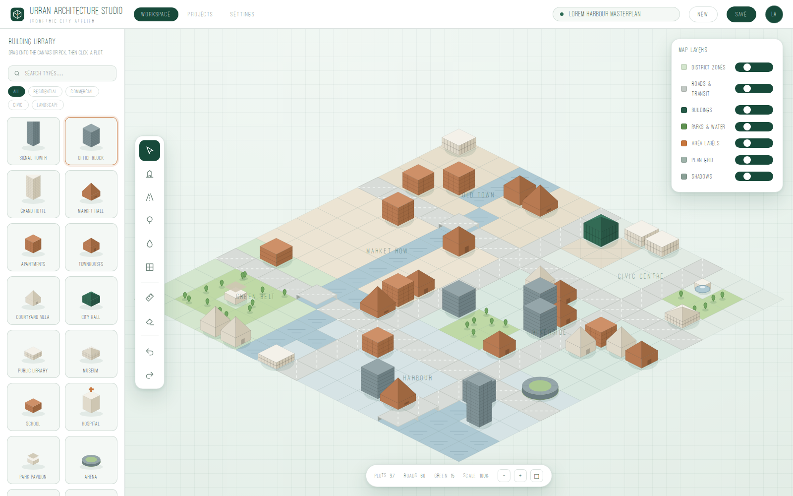

# Urban Architecture Studio

An interactive city-layout prototype with two visual themes, built with JavaScript, SVG, HTML and CSS.



## Try it

Open `direction_1_isometric_studio.html` or `direction_2_futuristic_workspace.html` in a modern desktop browser. Both files include their font and require no installation.

## Features

- Place, select and move buildings on an isometric canvas.
- Draw roads, parks and measurements.
- Pan, zoom, change map layers and inspect selected objects.
- Explore project-gallery and settings interfaces.
- Switch between calm isometric and futuristic workspace designs by opening the corresponding file.

## Source and rebuild

Editable HTML, CSS and JavaScript live in `source/*.html.tpl`. The Python script embeds the bundled font:

```sh
python3 source/build.py
```

## Scope

This is a front-end concept prototype. Sign-in is simulated; do not enter real credentials. It has no server or production account system. Some text is placeholder copy. The screenshot is a reference render from the alternate local iteration; details may differ.

## Validation

Both standalone files were rebuilt from their templates, and embedded JavaScript passed syntax checks. Interactive browser testing remains pending.

## Font credit

Ostrich Sans by Tyler Finck / The League of Moveable Type: https://www.theleagueofmoveabletype.com/ostrich-sans
